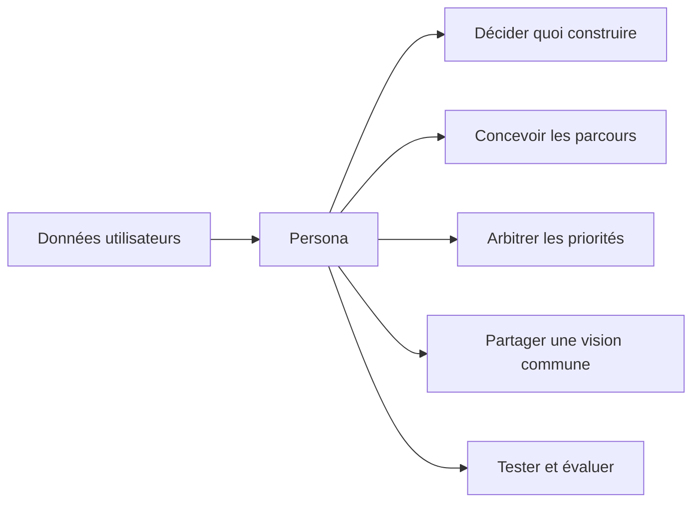

[Sommaire](Readme.md) · [Chapitre suivant →](02-Collecter-les-donnees.md)

# Comprendre la persona

## 🎯 Objectifs du chapitre

- Définir la persona et situer son origine.
- Savoir à quoi elle sert dans un projet, et à quoi elle ne sert pas.
- Distinguer persona, cible marketing, segment et proto-persona.
- Connaître les types de personas : primaire, secondaire, anti-persona.

---

## 1. Une définition

Une **persona** est un personnage fictif qui représente un groupe
d'utilisateurs réels partageant des objectifs, des comportements et des
frustrations semblables. Elle porte un prénom, un âge, un contexte de vie,
mais ces détails ne sont là que pour la rendre mémorable : ce qui compte, ce
sont **ses objectifs et ses comportements**, tirés de l'observation.

Trois idées tiennent dans cette définition :

- **fictive** : la persona n'est pas un utilisateur réel, c'est la synthèse
  de plusieurs ;
- **fondée sur des données** : chaque trait de la fiche se rattache à ce qui
  a été entendu ou observé ;
- **représentative d'un groupe** : elle ne décrit pas "l'utilisateur
  moyen", mais un ensemble cohérent de personnes qui utiliseraient le
  produit de la même façon.

## 2. D'où vient la persona ?

L'outil est popularisé par Alan Cooper à la fin des années 1990, dans
*The Inmates Are Running the Asylum* (1999). Son constat : les équipes
conçoivent pour un "utilisateur" abstrait et élastique, que chacun
étire selon ses préférences : le développeur l'imagine expert, le commercial
pressé, le chef de projet patient. Donner à cet utilisateur un visage et des
objectifs précis met fin à l'élasticité : on ne discute plus de "ce que
voudrait l'utilisateur", mais de "ce dont Nadia a besoin à 3 h du matin
pendant sa pause".

La méthode s'est ensuite étoffée (Cooper lui-même dans *About Face*, Pruitt
et Adlin dans *The Persona Lifecycle*) et s'est diffusée bien au-delà du
logiciel : services publics, marketing, formation, santé.

## 3. À quoi sert une persona ?

| Usage | Ce que la persona apporte |
|---|---|
| **Aligner l'équipe** | tout le monde parle du même utilisateur, avec les mêmes mots |
| **Décider** | "est-ce que Nadia en a besoin ?" tranche un débat de fonctionnalité |
| **Concevoir** | les scénarios et parcours partent de ses objectifs, pas de l'interface |
| **Prioriser** | on sert d'abord la persona primaire, sans casser les autres |
| **Recruter pour les tests** | on cherche des testeurs qui lui ressemblent |
| **Communiquer** | une page suffit à faire comprendre le public à un nouvel arrivant |

## 4. Ce qu'une persona n'est pas

| Ce n'est pas… | … parce que |
|---|---|
| **une cible marketing** | la cible dit *qui achète* (âge, revenus, CSP) ; la persona dit *comment et pourquoi on utilise* |
| **un segment** | le segment est une catégorie statistique ; la persona en est l'incarnation, avec des objectifs et un contexte |
| **l'utilisateur moyen** | la moyenne ne ressemble à personne ; la persona est une synthèse cohérente d'un groupe |
| **un portrait d'utilisateur réel** | un individu a ses singularités ; la persona n'en garde que ce que le groupe partage |
| **une fiche inventée en réunion** | sans données, elle ne fait que figer les intuitions de l'équipe |
| **une liste de fonctionnalités** | elle décrit des besoins ; les solutions viennent après |

> Une persona inventée est pire qu'une absence de persona : elle donne
> l'apparence de la rigueur à des suppositions.

## 5. Persona et proto-persona

Quand le temps ou le budget manque, on peut partir d'une **proto-persona** :
une hypothèse de persona, rédigée par l'équipe avec ce qu'elle sait déjà,
explicitement étiquetée comme provisoire. C'est une pratique courante en
*Lean UX*.

La proto-persona est utile **à condition d'être vérifiée** : elle dit ce qu'il
faut aller confirmer ou infirmer sur le terrain. Elle devient une persona
lorsque les données l'ont corrigée. Dans le canvas et la fiche fournis, la
ligne "Sources" sert précisément à cela : une proto-persona y porte
"aucune, hypothèse d'équipe".

## 6. Les types de personas

Un produit a rarement une seule persona, et il en a rarement plus de **cinq** :
au-delà, l'équipe ne les retient plus et elles cessent de servir. On les
hiérarchise. L'exemple du cours en retient deux, plus une anti-persona : c'est
un petit périmètre, adapté à un premier projet.

| Type | Rôle | Dans l'exemple |
|---|---|---|
| **Primaire** | celle pour qui on conçoit en priorité ; si elle est satisfaite, les autres le sont en grande partie | Nadia, infirmière de nuit, contrainte par ses horaires |
| **Secondaire** | ses besoins s'ajoutent à ceux de la primaire, sans les contredire | Hugo, développeur militant du local, exigeant sur la traçabilité |
| **Anti-persona** | celle pour qui on ne conçoit **pas** ; elle évite de dériver | le restaurateur qui cherche des volumes de gros au meilleur prix |

Deux remarques :

- **Une seule persona primaire par interface.** Si deux personas réclament des
  interfaces incompatibles, c'est souvent qu'il faut deux interfaces : par
  exemple, une application pour les consommateurs et un espace de gestion pour
  les producteurs, chacun avec sa persona primaire.
- **L'anti-persona est un outil de décision**, pas une caricature : elle est
  aussi fondée sur des données (des personnes réellement rencontrées dont on
  décide de ne pas servir les besoins).

## 7. L'exemple fil rouge

Tout le cours s'appuie sur le même cas :

> **Panier Local** est une plateforme qui permet de commander en ligne auprès
> de producteurs de la région lyonnaise et de retirer sa commande en point
> relais. L'équipe veut comprendre pourquoi beaucoup de visiteurs s'inscrivent
> puis ne commandent jamais.

Huit personnes ont été interviewées, et un questionnaire a recueilli 212
réponses. Les chapitres suivants montrent comment on passe de ces données à la
persona **Nadia Benali**.

---

## ✍️ Exercice

Pour chacune des phrases suivantes, dites s'il s'agit d'une description de
**cible marketing**, de **segment**, ou d'un élément de **persona**.

1. "Femmes de 35 à 50 ans, CSP+, urbaines."
2. "Commande pendant sa pause de nuit, sur son téléphone, en moins de deux
   minutes."
3. "23 % des inscrits n'ont jamais passé commande."
4. "Veut savoir combien touche le producteur sur chaque produit."

Voir la correction

1. **Cible marketing** : des critères sociodémographiques, sans rien sur
   l'usage.
2. **Persona** : un comportement concret, situé dans le temps et le contexte.
3. **Segment** (statistique) : une catégorie mesurée, sans objectifs ni
   contexte. C'est une donnée d'entrée, pas une persona.
4. **Persona** : un objectif exprimé par l'utilisateur, qui ira dans la
   rubrique "Objectifs" de la persona secondaire, Hugo.

---

[Sommaire](Readme.md) · [Chapitre suivant →](02-Collecter-les-donnees.md)
