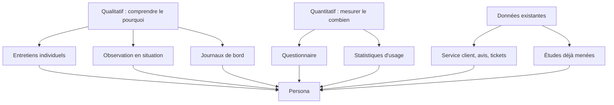

[← Chapitre précédent](01-Comprendre-la-persona.md) · [Sommaire](Readme.md) · [Chapitre suivant →](03-Analyser-et-segmenter.md)

# Collecter les données

## 🎯 Objectifs du chapitre

- Identifier les sources de données utiles à une persona.
- Recruter les bons participants.
- Préparer un guide d'entretien et mener l'entretien.
- Consigner les résultats dans une grille exploitable.

---

## 1. Ce qu'on cherche

On ne cherche pas à savoir *ce que les gens veulent* : ils le disent mal, et
proposent souvent des solutions plutôt que des besoins. On cherche à
comprendre **ce qu'ils font, pourquoi ils le font, et ce qui les en empêche**.

| On cherche… | Question type |
|---|---|
| des **objectifs** | "Qu'est-ce que vous essayiez d'obtenir, ce jour-là ?" |
| des **comportements** | "Racontez-moi la dernière fois que vous avez fait vos courses." |
| des **frustrations** | "Qu'est-ce qui vous a fait abandonner ?" |
| un **contexte** | "Où étiez-vous ? À quel moment de la journée ? Avec quoi ?" |
| des **contournements** | "Comment vous débrouillez-vous, aujourd'hui ?" |

## 2. Les sources



- **Les entretiens** sont la source principale : ils donnent les objectifs,
  le contexte et les verbatims.
- **L'observation** révèle l'écart entre ce que les gens disent et ce qu'ils
  font : la personne qui affirme "comparer les prix" et qui, en réalité,
  regarde seulement le total.
- **Le questionnaire** ne fait pas émerger une persona, mais il **vérifie** à
  quelle proportion du public correspond chaque groupe repéré en entretien.
- **Les données existantes** (statistiques d'usage, messages au service
  client, avis) sont gratuites et souvent sous-exploitées.

> Le qualitatif dit **pourquoi**, le quantitatif dit **combien**. Une persona
> solide a besoin des deux, dans cet ordre.

## 3. Recruter les participants

On recrute sur des **comportements**, pas sur des critères
sociodémographiques. Pour Panier Local, l'équipe a cherché :

- des personnes inscrites qui n'ont jamais commandé ;
- des personnes qui commandent régulièrement ;
- des personnes qui achètent local par d'autres moyens (marché, AMAP) ;
- des personnes qui n'achètent pas local du tout.

**Combien ?** Il n'y a pas de chiffre magique. On s'arrête quand les
entretiens n'apprennent plus rien de neuf : c'est la **saturation**. En
pratique, elle arrive souvent entre cinq et dix entretiens par profil pressenti.

L'exemple du cours en compte huit au total, soit deux ou trois par groupe :
c'est **trop peu pour un vrai projet**, et c'est volontaire, pour que les
calculs restent lisibles. Les décisions qui en découlent sont donc fragiles ;
l'exercice du chapitre 03 le montre en ajoutant un neuvième entretien qui
remet en question l'une d'elles.

## 4. Le guide d'entretien

Le guide n'est pas un questionnaire à dérouler : c'est un aide-mémoire des
thèmes à couvrir. L'entretien est **semi-directif** : on laisse parler, on
relance.

```text
1. Accueil : présentation, consentement, enregistrement
2. Contexte : "Parlez-moi de votre semaine type."
3. Le dernier épisode : "Racontez-moi vos dernières courses alimentaires."
4. Objectifs : "Qu'est-ce qui compte pour vous, dans ces courses ?"
5. Frustrations : "Qu'est-ce qui vous agace ? Qu'avez-vous abandonné ?"
6. Outils et canaux : "Avec quoi faites-vous cela ? Téléphone, ordinateur ?"
7. Contournements : "Comment vous débrouillez-vous quand ça ne marche pas ?"
8. Clôture : "Y a-t-il une question que j'aurais dû vous poser ?"
```

Quelques règles qui changent tout :

- **Faire raconter des épisodes réels**, pas des généralités : "la dernière
  fois que…" plutôt que "en général, est-ce que…".
- **Ne jamais présenter la solution.** "Est-ce que vous utiliseriez un casier
  24 h/24 ?" n'apprend rien : presque tout le monde répond oui.
- **Relancer sur les émotions et les écarts** : "Vous avez dit pénible :
  qu'est-ce qui était pénible ?"
- **Noter les verbatims mot pour mot** : ils feront la citation de la persona.

## 5. Éthique et données personnelles

Un entretien recueille des données personnelles : le RGPD s'applique.

- recueillir le **consentement** avant d'enregistrer, et dire à quoi servira
  l'entretien ;
- **anonymiser** dans la grille : un identifiant (`P1`, `P2`…), jamais le nom
  réel ;
- conserver les enregistrements le temps nécessaire, puis les supprimer ;
- ne jamais reprendre le nom, la photo ou un détail identifiant d'un
  participant dans la persona.

## 6. La grille de collecte

Juste après chaque entretien, on remplit une ligne de la grille. Le classeur
fourni (`modeles/persona-tableur-modele.ods`, onglet **Entretiens**, détaillé
au [chapitre 06](06-Les-modeles-tableur-et-texte.md)) propose ces colonnes :

| Colonne | Contenu |
|---|---|
| N° | identifiant anonyme : `P1`, `P2`… |
| Date | date de l'entretien |
| Profil | quelques mots de contexte : métier, âge, situation |
| Mode | visio, présentiel, téléphone |
| Objectifs exprimés | ce que la personne cherche à accomplir |
| Frustrations exprimées | ce qui la gêne ou l'a fait renoncer |
| Verbatim marquant | une phrase mot pour mot |
| Groupe | laissé vide : rempli après l'analyse (chapitre 03) |

Extrait de la grille de l'exemple :

| N° | Profil | Frustrations exprimées | Verbatim marquant |
|---|---|---|---|
| P1 | Infirmière de nuit, 41 ans, 2 enfants | Marché fermé à son réveil ; retrait AMAP le mardi à 18 h | "Je veux bien manger local, mais le marché ferme quand je me réveille." |
| P3 | Développeur en télétravail, 29 ans | "Local" qui veut dire 300 km ; labels flous | "Local, ça veut dire quoi ? 50 km, ou la région ?" |
| P5 | Étudiante, 21 ans, en colocation | Prix affichés sans le poids ni le prix au kilo | "Je regarde le total avant tout le reste." |

> Noter **ce qui a été dit**, pas ce qu'on en déduit. L'interprétation vient
> au chapitre suivant, et elle doit pouvoir être vérifiée par un collègue.

---

## ✍️ Exercice

Voici trois questions extraites d'un guide d'entretien. Reformulez-les pour
qu'elles respectent les règles de la section 4.

1. "Est-ce que vous aimeriez pouvoir commander la nuit ?"
2. "En général, vous faites vos courses où ?"
3. "Vous trouvez que les produits locaux sont trop chers ?"

<details>
<summary>Voir une correction possible</summary>

1. Elle présente une solution et appelle un "oui". Mieux : "À quel moment
   de la semaine faites-vous vos courses ? Pourquoi à ce moment-là ?"
2. Elle appelle une généralité. Mieux : "Racontez-moi vos dernières courses
   alimentaires : où, quand, comment ça s'est passé."
3. Elle suggère la réponse. Mieux : "Qu'est-ce qui compte pour vous quand
   vous choisissez où acheter ?" puis, si le prix vient : "Comment vous
   faites-vous une idée du prix ?"

</details>

---

[← Chapitre précédent](01-Comprendre-la-persona.md) · [Sommaire](Readme.md) · [Chapitre suivant →](03-Analyser-et-segmenter.md)
