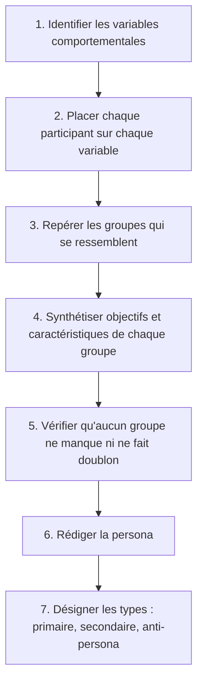
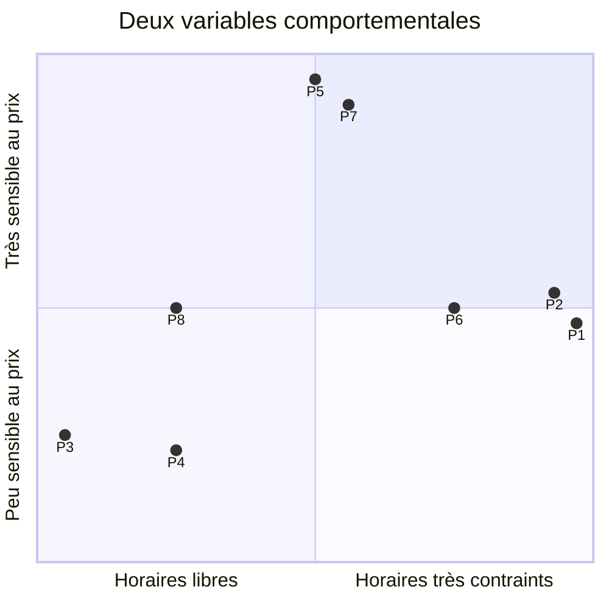

[← Chapitre précédent](02-Collecter-les-donnees.md) · [Sommaire](Readme.md) · [Chapitre suivant →](04-Rediger-la-persona.md)

# Analyser et segmenter

## 🎯 Objectifs du chapitre

- Identifier les variables comportementales qui distinguent les utilisateurs.
- Placer chaque participant sur ces variables.
- Repérer les groupes et décider lesquels deviennent des personas.
- Vérifier le poids de chaque groupe avec les données quantitatives.

---

## 1. La méthode en sept étapes

La démarche de ce chapitre et du suivant reprend celle d'Alan Cooper
(*About Face*), éprouvée et facile à outiller dans un tableur :

Les étapes 1 à 5 sont l'objet de ce chapitre ; les étapes 6 et 7, du suivant.

## 2. Les variables comportementales

Une **variable comportementale** est une dimension sur laquelle les
participants **diffèrent** et qui **change la façon dont ils utiliseraient le
produit**. On la formule comme un axe entre deux pôles.

On les trouve en relisant la grille de collecte et en cherchant ce qui oppose
les participants. Elles relèvent en général de cinq familles :

| Famille | Exemple d'axe |
|---|---|
| Activités | fréquence d'achat : *occasionnelle ↔ hebdomadaire* |
| Attitudes | motivation pour le local : *indifférente ↔ militante* |
| Aptitudes | aisance numérique : *débutante ↔ experte* |
| Motivations | ce qui déclenche l'achat : *prix ↔ valeurs* |
| Compétences / contraintes | contrainte horaire : *horaires libres ↔ très contraints* |

Pour Panier Local, l'équipe a retenu cinq variables :

| Variable | Pôle gauche (1) | Pôle droit (5) |
|---|---|---|
| Contrainte horaire | horaires libres | très contraints |
| Motivation "local" | indifférente | militante |
| Sensibilité au prix | faible | forte |
| Planification | au jour le jour | à la semaine |
| Aisance numérique | débutante | experte |

> L'âge, le sexe ou la ville ne sont **pas** des variables comportementales.
> Ils peuvent corréler avec un comportement, mais c'est le comportement qu'on
> retient.

## 3. Placer les participants

Chaque participant reçoit une note de 1 à 5 sur chaque variable, d'après ce
qu'il a dit ou fait en entretien. La précision n'est pas le but : ce qu'on
cherche, ce sont les **positions relatives**.

| N° | Contrainte horaire | Motivation "local" | Sensibilité au prix | Planification | Aisance numérique |
|---|:-:|:-:|:-:|:-:|:-:|
| P1 | 5 | 4 | 3 | 4 | 3 |
| P2 | 5 | 3 | 3 | 4 | 4 |
| P3 | 1 | 5 | 2 | 2 | 5 |
| P4 | 2 | 5 | 2 | 4 | 2 |
| P5 | 3 | 2 | 5 | 2 | 5 |
| P6 | 4 | 3 | 3 | 4 | 4 |
| P7 | 3 | 3 | 5 | 4 | 2 |
| P8 | 2 | 4 | 3 | 3 | 4 |

Cette table est l'onglet **Variables** du classeur fourni.

## 4. Repérer les groupes

On cherche les participants qui **se retrouvent ensemble sur plusieurs
variables à la fois**. Une seule variable ne fait pas un groupe ; trois ou
quatre variables qui regroupent les mêmes personnes, si.

Placés sur deux variables (contrainte horaire et sensibilité au prix), les
participants de l'exemple forment déjà trois nuages :

Les autres variables confirment ces regroupements. On nomme chaque groupe
d'après **ce qui le caractérise**, pas d'après un profil :

| Groupe | Participants | Ce qui les rassemble |
|---|---|---|
| **A : Contraints par l'horaire** | P1, P2, P6 | horaires décalés, planifient à la semaine, prix secondaire |
| **B : Militants du local** | P3, P4, P8 | motivation forte, exigence de traçabilité, peu de contrainte horaire |
| **C : Vigilants sur le budget** | P5, P7 | le prix décide de tout, la provenance vient ensuite |

Dans le classeur, la colonne **Groupe** de l'onglet Entretiens reçoit la lettre
du groupe ; l'onglet Variables calcule alors la **moyenne de chaque groupe**
sur chaque variable :

| Groupe | Contrainte horaire | Motivation "local" | Sensibilité au prix | Planification | Aisance numérique |
|---|:-:|:-:|:-:|:-:|:-:|
| A | 4,7 | 3,3 | 3,0 | 4,0 | 3,7 |
| B | 1,7 | 4,7 | 2,3 | 3,0 | 3,7 |
| C | 3,0 | 2,5 | 5,0 | 3,0 | 3,5 |

Ces moyennes donnent la position des curseurs sur le canvas
([chapitre 05](05-Le-canvas-graphique.md)) : une moyenne de 4,7 sur 5 place
le repère à (4,7 − 1) / 4 ≈ 92 % de l'axe.

## 5. Vérifier et décider

Avant de rédiger, deux vérifications :

**Complétude.** Chaque participant appartient-il à un groupe ? Un participant
isolé est soit un cas singulier (on l'écarte), soit le signe d'un groupe
sous-représenté (on fait d'autres entretiens).

**Poids.** Le questionnaire permet d'estimer la part de chaque groupe dans le
public. Dans l'exemple, en classant les 212 répondants selon les mêmes
critères :

| Groupe | Répondants | Part |
|---|:-:|:-:|
| A : Contraints par l'horaire | 87 | 41 % |
| B : Militants du local | 59 | 28 % |
| C : Vigilants sur le budget | 66 | 31 % |

**Décision.** L'équipe retient :

- le groupe **A** comme persona **primaire** (Nadia) : le plus nombreux, et
  celui dont les frustrations expliquent le mieux les inscrits qui ne
  commandent jamais ;
- le groupe **B** comme persona **secondaire** (Hugo) : ses besoins de
  traçabilité s'ajoutent sans rien casser ;
- le groupe **C** n'est pas retenu dans cette première version : le prix
  relève de la politique commerciale des producteurs, et une partie de ses
  attentes (prix au kilo, total visible) est déjà couverte par Nadia ;
- une **anti-persona**, le restaurateur qui cherche des volumes de gros au
  meilleur prix : elle ne vient pas des entretiens mais des **données
  existantes** (chapitre 02). Une quarantaine de demandes de ce type sont
  arrivées au service client depuis l'ouverture, et l'équipe décide de ne pas
  les servir : ni commande en palette, ni tarif dégressif.

> Ne pas retenir un groupe est une décision légitime, à condition d'être
> écrite et argumentée : l'onglet Variables du classeur exemple la consigne.

---

## ✍️ Exercice

Un neuvième entretien vient compléter l'étude :

> **P9** : Chauffeur-livreur, 38 ans. Commence à 5 h, finit à 14 h. Achète
> "ce qui est en promo". Ne s'intéresse pas à l'origine des produits.
> Fait ses courses tous les deux jours, sans liste. Commande tout sur son
> téléphone.

1. Placez P9 sur les cinq variables.
2. À quel groupe le rattachez-vous ? Change-t-il les décisions de la
   section 5 ?

Voir une correction possible

1. Contrainte horaire : **4** (horaires décalés, mais après-midi libre) ;
   motivation "local" : **1** ; sensibilité au prix : **5** ;
   planification : **1** ; aisance numérique : **4**.
2. P9 se rattache au groupe **C** : il partage avec P5 et P7 la sensibilité au
   prix, l'indifférence à la provenance et l'absence de planification. Sa
   contrainte horaire le rapproche du groupe A sur une seule variable, ce qui
   ne suffit pas à l'y placer.

   Le groupe C passe à trois participants : c'est un argument pour le
   réexaminer dans une version suivante, voire pour en faire une persona
   secondaire. La décision de la v1 n'est pas fausse, mais elle mérite d'être
   revue : c'est exactement ce qu'on note dans l'historique des versions.

---

[← Chapitre précédent](02-Collecter-les-donnees.md) · [Sommaire](Readme.md) · [Chapitre suivant →](04-Rediger-la-persona.md)
