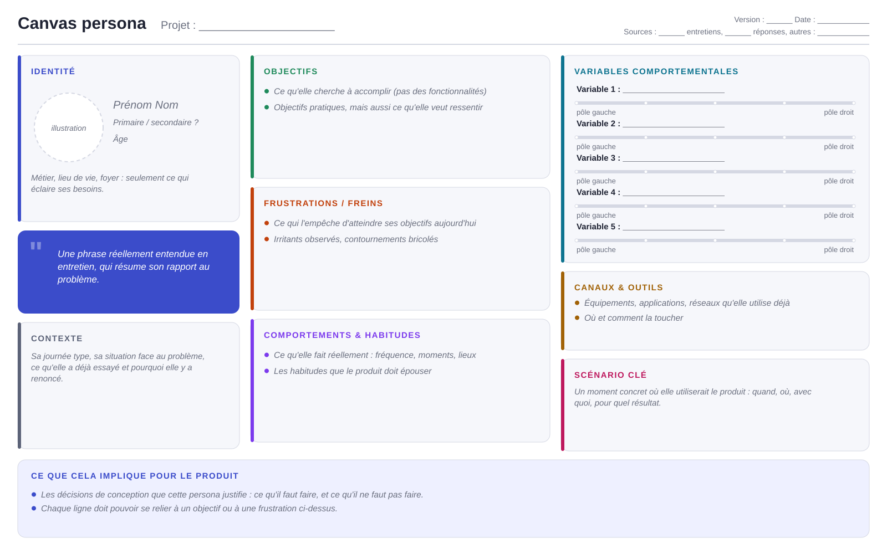
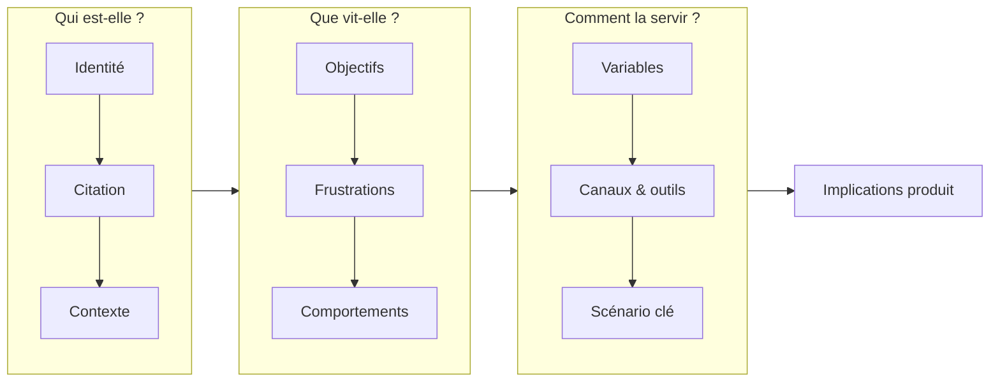
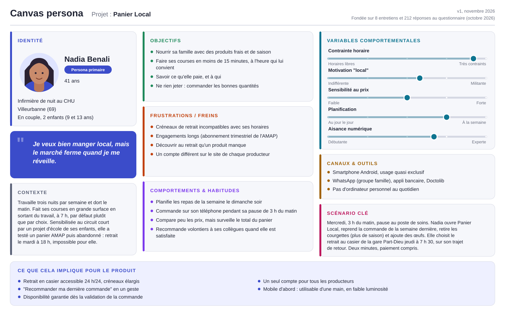

[← Chapitre précédent](04-Rediger-la-persona.md) · [Sommaire](Readme.md) · [Chapitre suivant →](06-Les-modeles-tableur-et-texte.md)

# Le canvas graphique

## 🎯 Objectifs du chapitre

- Connaître les zones du canvas persona et leur ordre de lecture.
- Remplir le canvas à partir de l'analyse.
- Choisir le bon support : papier, atelier, outil de dessin.

---

## 1. Pourquoi un canvas ?

La fiche texte est complète ; le canvas est **lisible d'un coup d'œil**. On
l'affiche au mur de l'équipe, on le projette en atelier, on le colle en tête
d'un document de conception. Il tient sur une page au format paysage, et chaque
zone a une place fixe : d'une persona à l'autre, on sait où regarder.

Le canvas est fourni en trois formats, chacun en version vierge et en version
remplie pour Nadia :

| Format | Fichiers | Usage |
|---|---|---|
| **SVG** (image vectorielle) | `assets/persona-canvas-vierge.svg`, `assets/persona-canvas-exemple.svg` | à imprimer en A3 pour un atelier, à intégrer dans une présentation, à retoucher dans un outil de dessin |
| **ODS** (tableur) | `modeles/persona-canvas-modele.ods`, `modeles/persona-canvas-exemple.ods` | à remplir au clavier ; les jauges des variables se dessinent seules à partir d'un pourcentage |
| **ODT** (texte) | `modeles/persona-canvas-modele.odt`, `modeles/persona-canvas-exemple.odt` | à remplir comme un document, à exporter en PDF pour diffusion |

Les trois reprennent les mêmes zones, à la même place, sur une page A4
paysage.

## 2. Le canvas vierge

Chaque zone porte, en gris, la consigne de ce qu'on y écrit.

## 3. Les zones et leur lecture

Le canvas se lit en trois colonnes, puis un bandeau :

| Zone | Ce qu'on y met | Règle |
|---|---|---|
| **En-tête** | projet, version, date, sources | jamais vide : c'est la traçabilité |
| **Identité** | illustration, prénom, type, âge, métier, lieu, foyer | une illustration neutre plutôt qu'une photo |
| **Citation** | le verbatim retenu | une phrase, entre guillemets |
| **Contexte** | un court paragraphe | ce qui rend ses objectifs compréhensibles |
| **Objectifs** | trois à cinq puces | des buts, pas des fonctionnalités |
| **Frustrations** | trois à cinq puces | entendues ou observées |
| **Comportements** | trois à cinq puces | des faits : quand, où, combien |
| **Variables** | un repère par curseur | position = (moyenne du groupe − 1) / 4 |
| **Canaux & outils** | deux ou trois puces | équipements et usages actuels |
| **Scénario clé** | un paragraphe au présent | un usage réussi, sans décrire l'interface |
| **Implications** | trois à six puces | chacune reliée à une zone au-dessus |

## 4. Les curseurs de variables

Les curseurs sont la zone la plus parlante quand on compare plusieurs
personas : on voit immédiatement ce qui les distingue. Leur position n'est pas
choisie au jugé : elle vient de l'onglet **Variables** du classeur
([chapitre 06](06-Les-modeles-tableur-et-texte.md)), qui calcule pour chaque
groupe une position en pourcentage.

| Variable | Moyenne du groupe A | Position du repère |
|---|:-:|:-:|
| Contrainte horaire | 4,7 | 92 % |
| Motivation "local" | 3,3 | 58 % |
| Sensibilité au prix | 3,0 | 50 % |
| Planification | 4,0 | 75 % |
| Aisance numérique | 3,7 | 67 % |

Dans le canvas vierge, les libellés des variables sont laissés libres : chaque
projet a les siennes.

## 5. L'exemple rempli

Quelques choix à remarquer :

- **L'illustration** est volontairement simple et non photographique.
- **La citation** est celle de P1, mot pour mot.
- **Les objectifs** sont formulés du point de vue de Nadia ("savoir ce
  qu'elle paie") et non du produit ("afficher les prix").
- **Le bandeau des implications** reprend des décisions qui découlent toutes
  d'une frustration, d'un comportement ou d'un canal visibles au-dessus.
- **L'en-tête** dit sur quoi repose la persona : 8 entretiens, 212 réponses,
  octobre 2026.

## 6. Utiliser le canvas

**En atelier.** Imprimer le canvas vierge en A3, une feuille par groupe
identifié au chapitre 03. Remplir au feutre ou avec des notes repositionnables,
en partant des objectifs et des frustrations ; l'identité vient en dernier.

**En version graphique.** Le SVG s'ouvre dans tout outil de dessin vectoriel :
Inkscape (libre), Figma (import par glisser-déposer), Illustrator, ou même
LibreOffice Draw. Les textes y sont de vrais textes, modifiables.

**Dans le tableur.** Le canvas `.ods` se remplit cellule par cellule : texte
dans chaque zone, et dans la zone Variables, une position en pourcentage par
variable (cellules jaunes). La jauge à cinq pastilles se dessine seule. Les
pourcentages se recopient depuis l'onglet **Variables** du classeur de
travail. L'impression tient sur une page A4 paysage.

**Dans le traitement de texte.** Le canvas `.odt` se remplit comme un
document : on remplace les consignes en gris, et on noircit les pastilles de
chaque variable (`●` pour une pastille pleine, `○` pour une vide). Pour
changer l'illustration, clic droit sur l'image puis *Remplacer*.

**À partir du classeur.** Une fois la persona stabilisée dans le classeur
`.ods`, on reporte rubrique par rubrique le contenu de l'onglet **Fiche
persona** dans le canvas.

> Le canvas est une **vitrine**. La source de vérité reste le classeur et ses
> données : si le canvas et le classeur divergent, c'est le classeur qui a
> raison.

---

## ✍️ Exercice

À partir de la description de Hugo (persona secondaire, chapitre 04, section 7)
et des moyennes du groupe B (chapitre 03), remplissez la zone **Variables** du
canvas : donnez la position de chaque repère en pourcentage.

Voir la correction

Moyennes du groupe B : 1,7 · 4,7 · 2,3 · 3,0 · 3,7.

| Variable | Calcul | Position |
|---|---|:-:|
| Contrainte horaire | (1,7 − 1) / 4 | 17 % |
| Motivation "local" | (4,7 − 1) / 4 | 92 % |
| Sensibilité au prix | (2,3 − 1) / 4 | 33 % |
| Planification | (3,0 − 1) / 4 | 50 % |
| Aisance numérique | (3,7 − 1) / 4 | 67 % |

Placé à côté de celui de Nadia, le canvas de Hugo montre d'un coup d'œil ce
qui les oppose (contrainte horaire et motivation) et ce qu'ils partagent :
l'aisance numérique.

---

[← Chapitre précédent](04-Rediger-la-persona.md) · [Sommaire](Readme.md) · [Chapitre suivant →](06-Les-modeles-tableur-et-texte.md)
