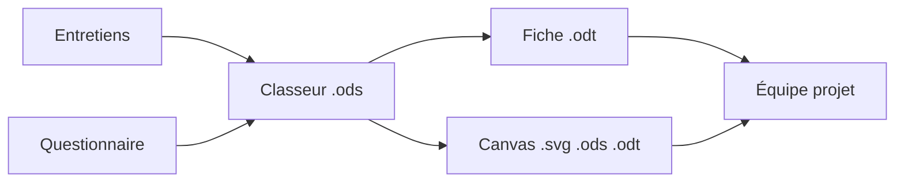

[← Chapitre précédent](05-Le-canvas-graphique.md) · [Sommaire](Readme.md) · [Chapitre suivant →](07-Faire-vivre-la-persona.md)

# Les modèles tableur et texte

## 🎯 Objectifs du chapitre

- Utiliser le classeur de travail pour passer des entretiens à la persona.
- Utiliser la fiche texte pour diffuser la persona.
- Savoir pourquoi ces modèles sont au format OpenDocument.

---

## 1. Trois documents, trois rôles

| Document | Rôle | Public |
|---|---|---|
| **Classeur** `.ods` | le **document de travail** : données brutes, calculs, décisions | l'équipe qui construit la persona |
| **Fiche** `.odt` | le **document de diffusion** : la persona rédigée, prête à lire | toute l'équipe projet, les nouveaux arrivants, les commanditaires |
| **Canvas** `.svg`, `.ods` ou `.odt` | la **vitrine** : la persona sur une page | le mur de l'équipe, les ateliers, les présentations |



Chacun existe en deux versions dans le dossier `modeles/` et dans `assets/` :
un **modèle** vierge, avec ses consignes, et un **exemple** rempli pour
Panier Local. Le canvas, présenté au [chapitre 05](05-Le-canvas-graphique.md),
existe en plus au format tableur et au format texte.

## 2. Pourquoi OpenDocument ?

OpenDocument (`.ods`, `.odt`) est un format **ouvert et normalisé** (ISO/IEC
26300). C'est le format par défaut de LibreOffice, et il s'ouvre aussi dans
Microsoft Office, Google Sheets / Docs ou OnlyOffice. Il est recommandé par le
Référentiel général d'interopérabilité pour les administrations françaises.

Concrètement : n'importe quel membre de l'équipe peut ouvrir les modèles, sans
licence, et les documents resteront lisibles dans dix ans.

## 3. Le classeur de travail

Fichiers : `modeles/persona-tableur-modele.ods` (vierge) et
`modeles/persona-tableur-exemple.ods` (rempli).

Le classeur suit la méthode, un onglet par étape :

| Onglet | Étape | Ce qu'on saisit | Ce qui se calcule |
|---|---|---|---|
| **Mode d'emploi** | - | rien | - |
| **Entretiens** | collecte (chapitre 02) | une ligne par participant ; la lettre du groupe après l'analyse | - |
| **Variables** | analyse (chapitre 03) | une note de 1 à 5 par participant et par variable | le groupe (repris des Entretiens), la moyenne et l'effectif de chaque groupe, la position des curseurs |
| **Fiche persona** | rédaction (chapitre 04) | le contenu de chaque rubrique | - |
| **Priorisation** | usage (chapitre 07) | le poids de chaque persona, une note de 0 à 3 par fonctionnalité | le score pondéré et le rang |

**Conventions visuelles.** Les cellules **jaunes** sont à saisir ; les
cellules **grises** se calculent seules ; les cellules en **italique gris**
sont des consignes à remplacer.

**Contrôles de saisie.** Les notes de l'onglet Variables n'acceptent qu'un
entier de 1 à 5, celles de l'onglet Priorisation un entier de 0 à 3 : une
faute de frappe est refusée à la saisie.

### Les formules, pour comprendre ce qui se passe

L'onglet **Variables** repose sur trois formules, qu'on peut adapter si l'on
ajoute des participants ou des variables :

```text
Groupe du participant      =SI(Entretiens.H4="";"";Entretiens.H4)
Moyenne du groupe A        =SIERREUR(MOYENNE.SI($G$4:$G$11;A14;B$4:B$11);"")
Position sur le curseur    =SI(B14="";"";(B14-1)/4)
```

L'onglet **Priorisation** pondère les notes par l'importance de chaque
persona, puis classe les fonctionnalités :

```text
Score pondéré              =SI(NB(B6:C6)=0;"";$B$3*B6+$C$3*C6)
Rang                       =SI(D6="";"";RANG(D6;D$6:D$13))
```

Les noms de fonctions sont ceux de LibreOffice en français ; le fichier, lui,
stocke les noms internationaux, et s'affiche dans la langue de chacun.

### Le pas-à-pas

1. **Après chaque entretien**, remplir une ligne de l'onglet Entretiens.
2. **Une fois les entretiens terminés**, choisir les variables
   comportementales et renommer les en-têtes de l'onglet Variables.
3. **Noter** chaque participant de 1 à 5 sur chaque variable.
4. **Repérer les groupes** (participants proches sur plusieurs variables) et
   reporter leur lettre dans la colonne Groupe de l'onglet Entretiens.
5. **Lire les moyennes** : elles décrivent chaque groupe ; consigner la
   décision (primaire, secondaire, non retenu) sous le tableau.
6. **Rédiger** la persona dans l'onglet Fiche persona.
7. **Prioriser** les fonctionnalités envisagées dans l'onglet Priorisation.

## 4. La fiche texte

Fichiers : `modeles/persona-fiche-modele.odt` (vierge) et
`modeles/persona-fiche-exemple.odt` (rempli).

La fiche reprend les rubriques du chapitre 04, mises en page pour être lues,
imprimées ou exportées en PDF :

| Section | Contenu |
|---|---|
| En-tête | projet, version, nom de la persona, sources |
| Fiche d'identité | tableau : type, âge, métier, lieu, foyer, groupe d'origine |
| Citation | encadré |
| Contexte, Objectifs, Frustrations, Comportements | paragraphes et listes |
| Variables comportementales | tableau avec une jauge à cinq pastilles par variable |
| Canaux et outils, Scénario clé | listes et paragraphe |
| Implications produit | tableau "décision / justifiée par" |
| Historique des versions | tableau des versions et des données ajoutées |
| Annexe (exemple) | le canvas graphique |

Dans le modèle, chaque section commence par une **consigne en italique gris**
à supprimer une fois la section rédigée. La jauge se remplit en remplaçant les
pastilles vides `○` par des pastilles pleines `●` : trois pastilles pleines
pour une position autour de 50 %, cinq pour une position au-delà de 90 %.

**L'historique des versions** est la section la plus négligée, et pourtant
celle qui donne confiance : elle dit au lecteur que la persona est tenue à
jour, et sur quoi reposent ses évolutions.

## 5. Bonnes pratiques de diffusion

- **Exporter en PDF** pour diffuser (*Fichier → Exporter au format PDF*), et
  garder le `.odt` comme source.
- **Nommer les fichiers** avec le projet, la persona et la version :
  `panier-local-persona-nadia-v1.odt`.
- **Ne pas diffuser le classeur** au-delà de l'équipe : même anonymisé, il
  contient des verbatims d'entretien.
- **Une persona, une fiche** : ne pas regrouper plusieurs personas dans un
  même document, chacune évolue à son rythme.

---

## ✍️ Exercice

Ouvrez `modeles/persona-tableur-exemple.ods`.

1. Dans l'onglet Entretiens, passez P8 du groupe B au groupe A. Comment
   évoluent les moyennes et la position des curseurs du groupe A ?
2. Dans l'onglet Priorisation, passez le poids de Hugo de 1 à 3. Quelle
   fonctionnalité gagne le plus de rangs ?

<details>
<summary>Voir la correction</summary>

1. Le groupe A compte désormais quatre participants. Sa contrainte horaire
   moyenne baisse de 4,7 à 4,0 (curseur de 92 % à 75 %) et sa motivation
   "local" monte de 3,3 à 3,5. Le groupe s'est **dilué** : c'est le signe
   que P8 n'y avait pas sa place, ce que confirmaient ses entretiens.
2. La **fiche producteur avec distance en km** passe de 6 points (rang 5) à
   12 points, et remonte au deuxième rang, ex æquo. Le poids donné à chaque
   persona est donc une décision lourde : c'est pour cela qu'il est saisi à
   part, en évidence, et qu'on le justifie.

</details>

---

[← Chapitre précédent](05-Le-canvas-graphique.md) · [Sommaire](Readme.md) · [Chapitre suivant →](07-Faire-vivre-la-persona.md)
