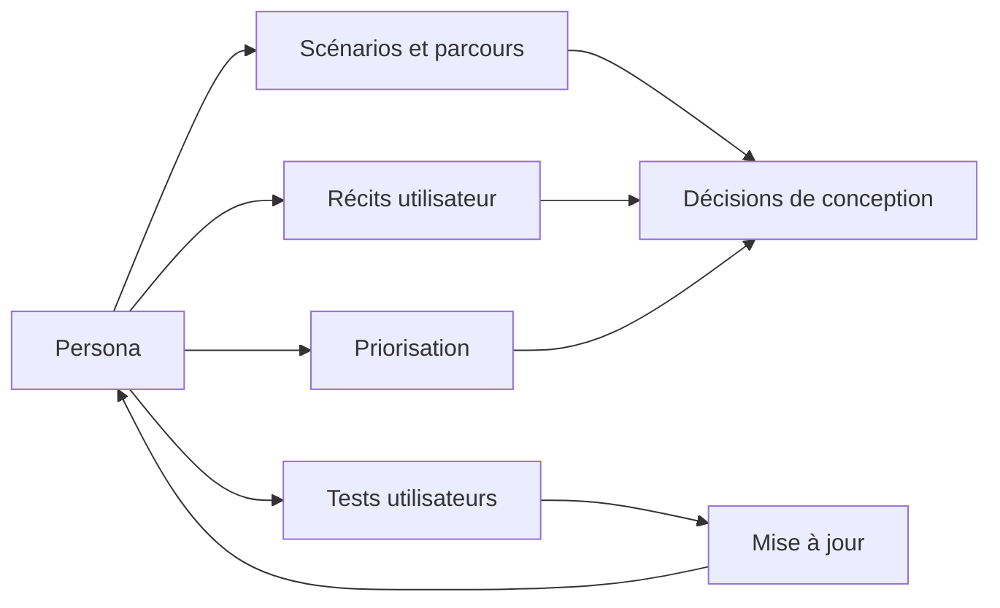

[← Chapitre précédent](06-Les-modeles-tableur-et-texte.md) · [Sommaire](Readme.md) · [Chapitre suivant →](08-La-persona-selon-votre-titre.md)

# Faire vivre la persona

## 🎯 Objectifs du chapitre

- Utiliser la persona pour concevoir : scénarios, parcours, récits
  utilisateur.
- L'utiliser pour décider : priorisation, arbitrages.
- La valider, la partager et la tenir à jour.

---

## 1. Une persona qui ne sert pas meurt

Le destin le plus fréquent d'une persona est le mur : imprimée, affichée,
puis plus jamais citée. Elle ne vit que si l'équipe **s'en sert pour décider**.
Ce chapitre présente les usages qui l'ancrent dans le quotidien du projet.



## 2. Des scénarios aux parcours

Le scénario clé de la fiche n'est qu'un début. Pour chaque objectif de la
persona, on peut écrire un scénario, puis le détailler en **parcours** :
une suite d'étapes, avec ce que la persona fait, pense et ressent à chacune.

| Étape | Nadia fait… | Elle pense / ressent… | Opportunité |
|---|---|---|---|
| Déclencheur | voit le frigo vide en rentrant à 7 h | "Encore la grande surface…" | rappel le dimanche soir, au moment où elle planifie |
| Commande | ouvre l'application pendant sa pause de nuit | pressée, fatiguée, faible luminosité | recommander la dernière commande, mode sombre |
| Choix du retrait | cherche un créneau compatible | inquiète : "Est-ce que ça tombera quand je peux ?" | casier 24 h/24 proposé en premier |
| Retrait | passe au casier sur son trajet | soulagée si tout est là | disponibilité garantie à la commande |
| Après | cuisine pour la famille | satisfaite, en parle à ses collègues | parrainage simple |

## 3. Des récits utilisateur nommés

Dans un projet agile, les récits utilisateur (*user stories*) s'écrivent
souvent "En tant qu'utilisateur, je veux…". Remplacer "utilisateur" par la
persona les rend **vérifiables** :

```text
En tant que Nadia,
je veux recommander ma dernière commande en un geste,
afin de faire mes courses pendant ma pause sans y passer plus de deux minutes.
```

Le "afin de" reprend un **objectif de la fiche**. Si l'on n'en trouve pas,
c'est que le récit ne sert aucune persona : il faut le justifier autrement, ou
le retirer.

Les critères d'acceptation peuvent eux aussi s'appuyer sur la persona :
utilisable d'une main, lisible en faible luminosité, réalisable en moins de
deux minutes.

## 4. Prioriser

L'onglet **Priorisation** du classeur (chapitre 06) note chaque
fonctionnalité de 0 à 3 pour chaque persona, puis pondère par l'importance de
la persona. Dans l'exemple :

| Rang | Fonctionnalité | Nadia (× 3) | Hugo (× 1) | Score |
|:-:|---|:-:|:-:|:-:|
| 1 | Disponibilité garantie dès la commande | 3 | 2 | 11 |
| 2 | Retrait en casier accessible 24 h/24 | 3 | 1 | 10 |
| 2 | "Recommander ma dernière commande" | 3 | 1 | 10 |
| 4 | Prix au kilo affiché partout | 2 | 2 | 8 |
| 5 | Fiche producteur avec distance en km | 1 | 3 | 6 |
| 5 | Mode faible luminosité | 2 | 0 | 6 |
| 7 | Programme de parrainage | 1 | 1 | 4 |
| 8 | Abonnement panier trimestriel | 0 | 2 | 2 |

Ce tableau ne décide pas à la place de l'équipe (le coût de réalisation, par
exemple, n'y figure pas), mais il rend les arbitrages **explicites** :
l'abonnement trimestriel, réclamé en réunion, ne sert presque personne, et
rappelle même une frustration de Nadia.

L'anti-persona sert aussi ici : une fonctionnalité qui ne servirait que le
restaurateur cherchant des volumes de gros (commande en palette, tarifs
dégressifs) sort de la liste.

## 5. Valider la persona

Une persona se vérifie, comme toute hypothèse :

- **Relecture par les personnes qui ont mené les entretiens** : "est-ce
  qu'on reconnaît P1, P2 et P6 ?"
- **Confrontation au quantitatif** : la proportion du groupe dans le
  questionnaire ou dans les statistiques d'usage est-elle cohérente ?
- **Test de recrutement** : peut-on trouver facilement des personnes qui
  correspondent à la persona pour un test utilisateur ? Si non, elle est
  peut-être trop spécifique, ou inventée.
- **Test de décision** : la persona permet-elle de trancher un vrai débat de
  l'équipe ? Si elle ne départage jamais rien, elle est trop vague.

## 6. Partager

- **Présenter** la persona à toute l'équipe, en une séance courte : d'où
  viennent les données, qui elle est, ce que cela implique.
- **Afficher** le canvas là où l'on travaille, physiquement ou dans l'espace
  numérique de l'équipe.
- **La citer** dans les documents de conception, les récits utilisateur, les
  comptes rendus de test.
- **L'intégrer à l'accueil** des nouveaux arrivants.

## 7. Mettre à jour

Une persona vieillit. Elle se révise :

- **après chaque vague de tests utilisateurs** qui la contredit ;
- quand le **public évolue** : nouveau territoire, nouvelle offre ;
- quand un **groupe écarté grossit** (le groupe C de l'exemple, au
  chapitre 03).

Chaque révision incrémente la version, et l'historique de la fiche dit ce qui
a changé et sur quelles données. Une persona sans date de mise à jour depuis
deux ans devrait être considérée comme une hypothèse.

---

## ✍️ Exercice de synthèse

Votre équipe reçoit trois demandes. Pour chacune, dites si la persona Nadia
la justifie, et rédigez le récit utilisateur correspondant le cas échéant.

1. "Ajouter une carte interactive de tous les producteurs."
2. "Envoyer une notification quand la commande est déposée au casier."
3. "Permettre de payer en espèces au retrait."

<details>
<summary>Voir une correction possible</summary>

1. **Pas pour Nadia.** Rien dans sa fiche ne dit qu'elle choisit ses
   producteurs ; elle veut aller vite. La demande sert plutôt Hugo (savoir
   d'où viennent les produits) : à évaluer avec sa fiche, en comparant avec
   la "fiche producteur avec distance en km" déjà envisagée.
2. **Oui.** Elle répond à la frustration "découvrir au retrait qu'un produit
   manque" et sécurise un trajet contraint :

   ```text
   En tant que Nadia,
   je veux être prévenue quand ma commande est déposée et complète,
   afin de ne passer au casier que si tout est là, sur mon trajet de retour.
   ```

3. **Non.** Le paiement en ligne fait partie de son scénario ("paiement
   compris") et le casier 24 h/24 rend le paiement sur place impossible.
   Si la demande vient du terrain, elle signale peut-être un autre groupe
   d'utilisateurs : c'est une piste pour de nouveaux entretiens, pas une
   fonctionnalité à ajouter pour Nadia.

</details>

---

[← Chapitre précédent](06-Les-modeles-tableur-et-texte.md) · [Sommaire](Readme.md) · [Chapitre suivant →](08-La-persona-selon-votre-titre.md)
