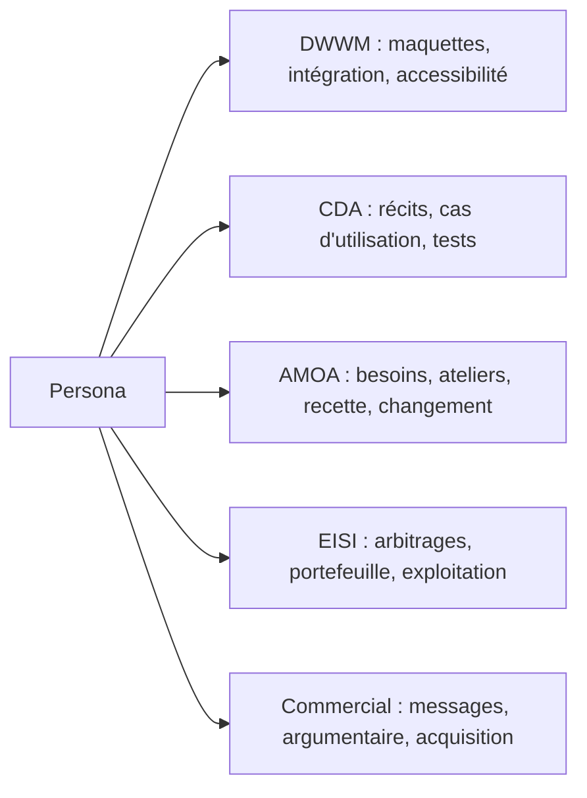
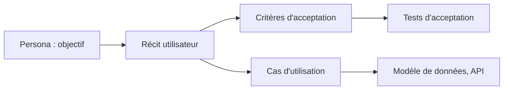

[← Chapitre précédent](07-Faire-vivre-la-persona.md) · [Sommaire](Readme.md) · [Chapitre suivant →](09-Persona-d-usage-et-persona-commerciale.md)

# La persona selon votre titre

## 🎯 Objectifs du chapitre

- Situer la persona dans le métier visé par votre titre.
- Savoir quels livrables de votre métier s'appuient sur elle.
- Identifier les chapitres du cours sur lesquels insister.

---

## 1. Une méthode, plusieurs métiers

La méthode est la même pour tous ; ce qui change, c'est **ce qu'on en fait**.
Le développeur en tire des écrans, le concepteur des récits utilisateur et des
cas d'utilisation, l'AMOA une expression de besoins et une recette, l'expert
SI des arbitrages, le commercial des messages et un argumentaire.



| Titre | Ce que la persona alimente | Chapitres prioritaires |
|---|---|---|
| **DWWM** : Développeur web et web mobile | maquettes, choix d'interface, accessibilité, contenus | 01, 04, 05, 07 |
| **CDA** : Concepteur développeur d'applications | récits utilisateur, cas d'utilisation, critères d'acceptation, tests | 01, 03, 04, 07 |
| **AMOA** : Consultant en assistance à maîtrise d'ouvrage informatique | entretiens, ateliers, expression de besoins, recette, conduite du changement | 02, 03, 06, 07, 09 |
| **EISI** : Expert en informatique et systèmes d'information | cadrage, priorisation du portefeuille, personas internes et d'exploitation | 01, 03, 07 |
| **Métiers commerciaux** | ciblage, messages, argumentaire, parcours d'achat | 01, 04, 09 |

Les sections qui suivent détaillent chaque titre. On peut ne lire que la sienne,
mais lire celle des autres aide à comprendre ce que vos collègues attendront de
la persona.

---

## 2. DWWM : la persona derrière l'écran

Le développeur web et web mobile **maquette et réalise les interfaces**. Il ne
mène pas toujours la recherche lui-même, mais il est celui qui transforme la
persona en pixels : chaque choix d'interface devrait pouvoir se justifier par
elle.

**Ce qu'il en tire**

| Élément de la persona | Décision d'interface |
|---|---|
| Canaux : smartphone, usage quasi exclusif | conception *mobile first*, puis élargissement aux grands écrans |
| Comportement : commande pendant la pause de nuit | thème sombre, contrastes élevés, pas d'animation agressive |
| Contexte : pause au poste de soins, fatigue, une main souvent occupée | cibles tactiles larges, actions principales en bas de l'écran |
| Objectif : moins de deux minutes | parcours court, "recommander" en page d'accueil, peu de saisie |
| Aisance numérique moyenne (67 %) | vocabulaire courant, icônes toujours accompagnées d'un libellé |

**L'accessibilité.** Une persona met souvent en évidence des situations de
handicap temporaires ou situationnelles : fatigue, faible luminosité, une seule
main disponible. Elles rejoignent les exigences d'accessibilité (RGAA, WCAG) :
contrastes, taille des cibles, alternatives textuelles. La persona est un bon
argument pour défendre ces exigences face à un "on verra plus tard".

**Livrable type** : une maquette annotée, où chaque annotation renvoie à une
rubrique de la persona.

```text
[Écran d'accueil : mobile]
① Bouton "Recommander ma dernière commande", en bas, pleine largeur
   → Nadia : commande pendant sa pause, planifie à la semaine
② Thème sombre par défaut entre 22 h et 7 h
   → Nadia : usage nocturne, faible luminosité
③ Créneau "casier 24 h/24" proposé en premier
   → Nadia : frustration sur les créneaux de retrait
```

**À travailler** : chapitres 04 (les implications produit), 05 (le canvas
comme référence affichée pendant la maquette) et 07 (les parcours).

---

## 3. CDA : de la persona au modèle

Le concepteur développeur d'applications **analyse le besoin, conçoit et
développe** une application, souvent en équipe agile. La persona est l'entrée
de sa chaîne de conception : elle donne les acteurs, les récits, les critères
d'acceptation et les scénarios de test.

**Persona, acteur, rôle : ne pas confondre**

| Notion | Ce que c'est | Exemple |
|---|---|---|
| **Persona** | un archétype d'utilisateur, avec objectifs et contexte | Nadia, Hugo |
| **Acteur** (UML) | un rôle qui interagit avec le système | Client, Producteur, Administrateur |
| **Rôle** (sécurité) | un ensemble de droits | `ROLE_CLIENT`, `ROLE_PRODUCTEUR` |

Nadia et Hugo sont deux personas d'un **même acteur**, "Client". Le modèle UML
reste sobre ; c'est la persona qui dit **comment** cet acteur utilise le
système, et donc quels cas d'utilisation prioriser.

**La chaîne de conception**



Exemple, de bout en bout :

```text
Objectif de Nadia      Faire ses courses en moins de 15 minutes, à l'heure qui lui convient.
Récit utilisateur      En tant que Nadia, je veux recommander ma dernière commande,
                       afin de faire mes courses pendant ma pause.
Cas d'utilisation      "Recommander une commande", acteur : Client.
Critères               Étant donné une commande passée,
d'acceptation          quand je choisis "Recommander",
                       alors un panier identique est créé,
                       et les produits indisponibles sont signalés avant validation.
Conséquence technique  La disponibilité doit être connue au moment de la commande :
                       le stock des producteurs devient une donnée du modèle.
```

La dernière ligne est la plus intéressante : une frustration de la persona
("découvrir au retrait qu'un produit manque") a produit une **exigence
d'architecture**. C'est le signe que la persona a été utilisée jusqu'au bout.

**Les exigences non fonctionnelles** se tirent aussi de la persona : temps de
réponse sur réseau mobile, fonctionnement en connexion dégradée (un sous-sol
d'hôpital), sécurité du paiement sur mobile.

**À travailler** : chapitres 03 (les variables, pour savoir combien de
personas modéliser), 04 et 07 (récits et critères d'acceptation).

---

## 4. AMOA : la persona au service de la maîtrise d'ouvrage

Le consultant en assistance à maîtrise d'ouvrage **fait le lien entre les métiers et la
réalisation** : il recueille et formalise les besoins, anime les ateliers,
rédige l'expression de besoins, organise la recette et accompagne le
changement. C'est le titre pour lequel la **construction** de la persona est le
plus directement un geste professionnel.

**Ce qu'il en tire**

| Activité AMOA | Apport de la persona |
|---|---|
| Recueil des besoins | le guide d'entretien et la grille de collecte (chapitre 02) sont ses outils quotidiens |
| Animation d'ateliers | le canvas imprimé structure un atelier ; il met les parties prenantes d'accord sur "pour qui" avant "quoi" |
| Expression de besoins | chaque exigence se rattache à une persona et à un objectif : la traçabilité est assurée |
| Priorisation | l'onglet Priorisation objective les arbitrages entre métiers (chapitre 07) |
| Recette | les scénarios de recette se rédigent à partir des scénarios des personas |
| Conduite du changement | des **personas internes** décrivent les utilisateurs métiers touchés par le projet |

**Les personas internes.** En maîtrise d'ouvrage, les utilisateurs sont
souvent des collaborateurs : agents, gestionnaires, opérateurs. Pour Panier
Local, l'équipe pourrait construire la persona de l'**opérateur logistique**
qui remplit les casiers à 6 h, ou du **producteur** qui saisit ses stocks le
soir. La méthode est identique ; seuls le recrutement (accès aux équipes,
accord de la hiérarchie) et l'éthique (anonymat vis-à-vis du management)
demandent une attention particulière.

**Une exigence tracée**

| Réf. | Exigence | Persona | Objectif / frustration | Priorité |
|---|---|---|---|---|
| EX-12 | Le client peut retirer sa commande dans un casier accessible 24 h/24 | Nadia | Frustration : créneaux incompatibles | Haute |
| EX-17 | La fiche producteur affiche la distance en kilomètres | Hugo | Objectif : connaître l'origine exacte | Moyenne |

**Un scénario de recette**

```text
RE-04 : Recommander une commande la nuit (persona : Nadia)
Préalable  : une commande passée la semaine précédente, dont un produit est épuisé.
Étapes     : à 3 h, sur smartphone, ouvrir l'application et recommander.
Attendu    : le produit épuisé est signalé avant paiement ; un casier 24 h/24 est proposé ;
             le parcours complet prend moins de deux minutes.
```

**À travailler** : chapitres 02 (collecte), 03 (analyse, car c'est souvent
l'AMOA qui la conduit), 06 (le classeur comme outil de traçabilité) et 07.

---

## 5. EISI : la persona à l'échelle du système d'information

L'expert en informatique et systèmes d'information **conçoit, pilote et fait
évoluer le SI** : stratégie, architecture, portefeuille de projets,
exploitation. Il construit rarement une persona lui-même ; il s'en sert pour
**cadrer et arbitrer**, et il en étend l'usage à des publics que les autres
titres oublient.

**Ce qu'il en tire**

| Activité EISI | Apport de la persona |
|---|---|
| Cadrage d'un projet | vérifier que le besoin repose sur des utilisateurs identifiés, et non sur une intuition |
| Arbitrage de portefeuille | comparer des projets selon les personas qu'ils servent et le poids de chacune (chapitre 03) |
| Architecture | traduire les contraintes des personas en exigences : disponibilité 24 h/24, mobile, montée en charge le dimanche soir |
| Exploitation et DevOps | construire les **personas d'exploitation** : l'équipe d'astreinte, le support |
| Sécurité | construire des **anti-personas malveillantes** : le fraudeur, le robot qui réserve tous les casiers |

**Les personas d'exploitation.** Un système est aussi utilisé par ceux qui le
font tourner. Une persona "ingénieur d'astreinte" (réveillé à 4 h par une
alerte, sur son téléphone, sans contexte) justifie des tableaux de bord
lisibles, des alertes explicites et des procédures courtes. La démarche est
la même : entretiens, variables, synthèse.

**Les anti-personas de sécurité.** Une anti-persona n'est pas seulement
"celui pour qui on ne conçoit pas" : elle peut décrire celui **contre qui on
conçoit**. Pour Panier Local, un acteur malveillant qui réserve tous les
casiers d'une gare pour les revendre justifie des limites de réservation et
une détection d'abus. Cette pratique rejoint la modélisation des menaces.

**Les indicateurs.** À l'échelle d'un SI, on mesure ce que chaque persona
vit : pour Nadia, le taux de commandes passées entre 0 h et 6 h et le taux de
ruptures découvertes au retrait. Une persona devient alors un **axe de
pilotage**, pas seulement un outil de conception.

**À travailler** : chapitres 01 (les types de personas, anti-persona
comprise), 03 (le poids des groupes pour arbitrer) et 07 (validation et mise
à jour, à l'échelle de plusieurs projets).

---

## 6. Les métiers commerciaux

Pour les profils commerciaux (vente, marketing, relation client, et tous les
titres ci-dessus quand ils travaillent avec eux), la persona prend une autre
forme : la **persona commerciale** (*buyer persona*). Elle répond à la
question "qui achète, et pourquoi ?" plutôt que "qui utilise, et
comment ?".

Les deux se recoupent largement, et c'est une erreur fréquente de les
construire séparément, ou au contraire de les confondre. Le
[chapitre 09](09-Persona-d-usage-et-persona-commerciale.md) leur est consacré :
ce qui les distingue, et comment passer de l'une à l'autre dans les deux sens.

---

## ✍️ Exercice

Choisissez la ligne de votre titre et produisez le livrable demandé, à partir
de la persona de Nadia.

| Titre | Livrable |
|---|---|
| DWWM | la maquette annotée de l'écran de choix du retrait (trois annotations au moins) |
| CDA | un récit utilisateur, ses critères d'acceptation et la conséquence technique qu'il implique, pour la frustration "un compte différent sur le site de chaque producteur" |
| AMOA | une exigence tracée et un scénario de recette pour la frustration "engagements longs" |
| EISI | deux indicateurs de pilotage pour Nadia, et une anti-persona de sécurité supplémentaire |

<details>
<summary>Voir des éléments de correction</summary>

- **DWWM** : le casier 24 h/24 en première position (frustration : créneaux) ;
  les créneaux présentés par plage horaire, nuit comprise (contexte : horaires
  décalés) ; le lieu le plus proche du trajet habituel mémorisé (comportement :
  même trajet chaque semaine) ; des cibles tactiles larges (canal : une main).
- **CDA** : "En tant que Nadia, je veux commander chez plusieurs producteurs
  avec un seul compte et un seul paiement, afin de ne pas multiplier les
  inscriptions." Critère : un panier peut contenir des produits de plusieurs
  producteurs et se paie en une transaction. Conséquence technique : un modèle
  de commande multi-vendeurs, avec une répartition du paiement entre
  producteurs.
- **AMOA** : EX-21 : "La commande est ponctuelle, sans engagement de
  durée ; un abonnement éventuel reste optionnel et résiliable à tout moment"
  (Nadia, frustration : engagements longs). Recette : vérifier qu'une commande
  peut être passée sans souscrire d'abonnement, et qu'aucun écran du parcours
  n'oblige à en choisir un.
- **EISI** : indicateurs (autres que ceux du texte) : part des commandes
  passées avec "Recommander ma dernière commande" ; taux d'occupation des
  casiers en dehors de 8 h-20 h ; délai médian du parcours de commande sur
  mobile. Anti-persona : le compte qui crée de nombreuses
  commandes non payées pour bloquer le stock d'un producteur concurrent →
  délai d'expiration des paniers et limite de réservations simultanées.

</details>

---

[← Chapitre précédent](07-Faire-vivre-la-persona.md) · [Sommaire](Readme.md) · [Chapitre suivant →](09-Persona-d-usage-et-persona-commerciale.md)
