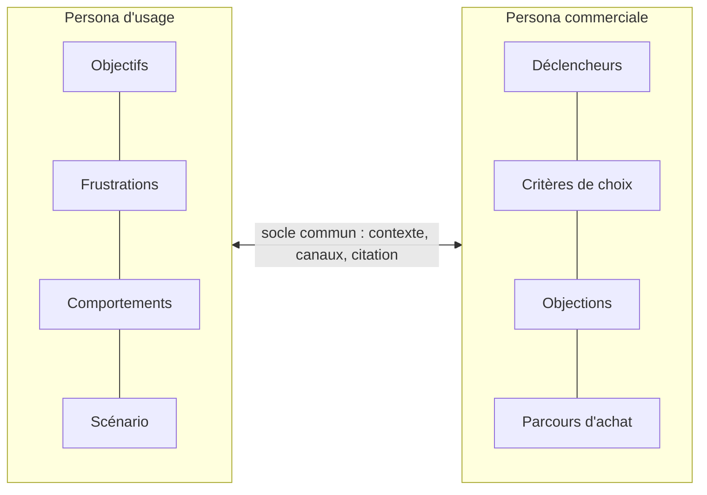

[← Chapitre précédent](08-La-persona-selon-votre-titre.md) · [Sommaire](Readme.md) · [Chapitre suivant →](A-Ressources.md)

# Persona d'usage et persona commerciale

## 🎯 Objectifs du chapitre

- Distinguer la persona d'usage de la persona commerciale (*buyer persona*).
- Connaître les rubriques propres à la persona commerciale.
- Réutiliser une persona d'usage dans un cadre commercial.
- Réutiliser une persona commerciale dans un cadre non commercial.
- Éviter les pièges de ces transferts, y compris sur le plan du RGPD.

---

## 1. Deux personas, deux questions

Jusqu'ici, ce cours a construit des **personas d'usage** : elles servent à
concevoir un produit ou un service. Les équipes commerciales et marketing
construisent, elles, des **personas commerciales** (on parle aussi de
*buyer personas*) qui servent à vendre.

| | Persona d'usage | Persona commerciale |
|---|---|---|
| **Question** | Qui utilise, et comment ? | Qui achète, et pourquoi ? |
| **Sert à** | concevoir, prioriser, tester | cibler, convaincre, accompagner la décision d'achat |
| **Utilisée par** | conception, développement, AMOA, produit | marketing, vente, relation client, direction |
| **Moment couvert** | l'usage : avant, pendant, après | la décision : découverte, comparaison, achat, fidélisation |
| **Sources** | entretiens d'usage, observation, statistiques d'usage | entretiens d'acheteurs, CRM, retours des commerciaux, analyse des ventes gagnées et perdues |
| **Rubriques clés** | objectifs, frustrations, comportements, scénario | déclencheurs, critères de choix, objections, parcours d'achat, rôle dans la décision |
| **Livrables** | maquettes, récits, exigences, recette | messages, argumentaire, contenus, ciblage des campagnes |

Les deux décrivent souvent **les mêmes personnes**, vues sous deux angles. En
B2C, l'acheteuse et l'utilisatrice sont fréquemment une seule personne : Nadia
choisit Panier Local *et* l'utilise. En B2B, elles sont presque toujours
différentes : celui qui signe n'est pas celui qui se sert de l'outil.

## 2. Les rubriques propres à la persona commerciale

Une persona commerciale reprend l'identité, le contexte, la citation et les
canaux, et ajoute ce qui éclaire la **décision d'achat**. Adele Revella
(*Buyer Personas*, 2015) en propose cinq, souvent reprises :

| Rubrique | Question | Exemple pour Nadia |
|---|---|---|
| **Déclencheur** | Qu'est-ce qui la pousse à chercher une solution maintenant ? | la rentrée scolaire et un projet d'école sur l'alimentation de ses enfants |
| **Résultat attendu** | À quoi verra-t-elle que c'était le bon choix ? | des repas de saison sans courses supplémentaires dans la semaine |
| **Freins perçus** | Qu'est-ce qui la fait hésiter, ou renoncer ? | "encore un abonnement", la peur des créneaux impossibles, le prix supposé |
| **Parcours d'achat** | Comment s'informe-t-elle, compare-t-elle, décide-t-elle ? | bouche-à-oreille entre collègues, groupe WhatsApp, essai sur une première commande |
| **Critères de décision** | Sur quoi compare-t-elle les offres ? | compatibilité avec ses horaires, absence d'engagement, total du panier |

On y ajoute selon le contexte :

- **le rôle dans la décision**, surtout en B2B : initiateur, prescripteur,
  décideur, acheteur, utilisateur, filtre ;
- **la valeur** : panier moyen, fréquence, durée de vie estimée du client ;
- **la concurrence perçue** : ce à quoi elle compare l'offre (ici, la grande
  surface du trajet retour, pas une autre plateforme) ;
- **les messages** : ce qui la touche, avec ses mots.

## 3. De la persona d'usage à la persona commerciale

C'est le sens le plus courant : l'équipe produit a construit Nadia, le
marketing veut s'en servir pour la campagne de lancement.

### 3.1 Ce qui se transfère directement

| Persona d'usage | devient… | Exemple |
|---|---|---|
| Objectifs | **bénéfices** mis en avant | "Vos courses locales en deux minutes, quand vous voulez." |
| Frustrations | **objections à lever** et arguments | "Sans abonnement. Retrait 24 h/24." |
| Citation | **accroche** et ton des messages | "Le marché ferme quand vous vous réveillez ? Pas le casier." |
| Canaux & outils | **canaux d'acquisition** | mobile, partage WhatsApp, parrainage entre collègues |
| Comportements | **moments de contact** | une notification le dimanche soir, quand elle planifie |
| Scénario clé | **démonstration** | la vidéo de 30 secondes qui montre la commande à 3 h du matin |

### 3.2 Ce qu'il faut ajouter

La persona d'usage ne dit rien de **la décision** : pourquoi Nadia
essaierait-elle, qu'est-ce qui la ferait abandonner avant la première commande,
combien elle rapporte. Il faut donc :

- **compléter la collecte** par quelques questions d'achat : "Comment avez-vous
  découvert… ?", "Qu'est-ce qui vous a fait hésiter ?", "À quoi avez-vous
  comparé ?" ;
- **croiser avec les données commerciales** : sources d'inscription, taux de
  conversion, paniers moyens ;
- **interroger les personnes qui ont renoncé** : les inscrits qui ne
  commandent jamais sont justement le problème de départ de Panier Local.

### 3.3 L'exemple : Nadia, vue commerciale

| Rubrique | Contenu |
|---|---|
| Déclencheur | rentrée, projet d'école, fatigue des courses en grande surface à 7 h |
| Résultat attendu | des repas de saison sans courses supplémentaires dans la semaine |
| Freins perçus | engagement, créneaux, prix supposé, "encore une appli" |
| Parcours d'achat | entend parler par une collègue → regarde sur son téléphone pendant la pause → première commande d'essai |
| Critères de décision | horaires, sans engagement, total visible avant de valider |
| Concurrence perçue | le supermarché sur le trajet, pas l'AMAP (déjà abandonnée) |
| Valeur | une commande par semaine, foyer de quatre |
| Message principal | "Le local, à vos horaires. Sans abonnement." |
| Canaux | parrainage entre collègues, affichage dans les salles de pause des hôpitaux, partage WhatsApp |

Remarquez l'idée de l'affichage en salle de pause : elle vient directement du
**contexte** de la persona d'usage. C'est tout l'intérêt du transfert.

### 3.4 Les pièges

- **Transformer une frustration en promesse non tenue.** "Disponibilité
  garantie" ne peut être un argument que si le produit la garantit vraiment.
  Le marketing ne doit promettre que ce que les implications produit ont
  réellement livré.
- **Réduire la persona à une cible.** Remplacer Nadia par "femmes 35-50 ans,
  urbaines" perd ce qui la rendait utile : la contrainte horaire, qui touche
  aussi le conducteur de bus et l'agent de sécurité du groupe A.
- **Réutiliser les données d'entretien hors de leur finalité.** Voir la
  section 5.

## 4. De la persona commerciale à la persona d'usage

C'est le sens le plus négligé, et pourtant fréquent : l'équipe commerciale a
déjà ses personas, et l'équipe produit démarre un projet. Faut-il tout
recommencer ? Non, mais il ne faut pas tout reprendre non plus.

### 4.1 L'exemple : Sophie, élue du CSE

Pour développer les retraits en casier, l'équipe commerciale de Panier Local
démarche les comités sociaux et économiques (CSE) des grands employeurs :
installer un casier sur le site, offrir une remise aux salariés. Elle a
construit cette persona commerciale :

> **Sophie Marchand**, 46 ans, cadre administrative, secrétaire du CSE d'un
> centre hospitalier.
> *"Je veux des avantages que les gens de nuit peuvent vraiment utiliser."*
>
> - **Déclencheur** : une enquête interne où les équipes de nuit se disent
>   oubliées par les avantages du CSE.
> - **Critères de décision** : utile aux équipes de nuit, aucun travail
>   supplémentaire pour les élus, budget prévisible.
> - **Freins perçus** : la gestion des inscriptions, les réclamations à traiter.
> - **Rôle** : prescriptrice et co-décideuse, avec le bureau du CSE et la
>   direction pour l'emplacement du casier.

L'équipe produit doit maintenant concevoir l'**espace partenaire** que le CSE
utilisera.

### 4.2 Ce qui se transfère

| Persona commerciale | devient… | Dans l'espace partenaire |
|---|---|---|
| Freins perçus | **frustrations** à résoudre par la conception | inscription des salariés en libre-service, sans action des élus |
| Critères de décision | **objectifs** d'usage | un tableau de bord qui montre l'usage par les équipes de nuit |
| Contexte et contraintes | **contexte** | élue bénévole, peu de temps, mandat de quatre ans |
| Canaux | **canaux & outils** | ordinateur au bureau du CSE, messagerie professionnelle |

### 4.3 Ce qui ne se transfère pas, et ce qu'il faut vérifier

- **L'acheteur n'est pas forcément l'utilisateur.** Sophie signe, mais qui
  utilisera l'espace partenaire au quotidien ? Peut-être l'assistante du CSE.
  Il faut alors une persona d'usage distincte.
- **La persona commerciale décrit une décision, pas un usage.** Elle ne dit
  rien de la fréquence de connexion, des tâches réelles, des erreurs
  possibles : il faut les observer.
- **Elle repose souvent sur l'avis des commerciaux** plutôt que sur des
  entretiens. Elle doit alors être traitée comme une **proto-persona**
  (chapitre 01) : une hypothèse à vérifier par quelques entretiens d'usage.
- **Les critères sociodémographiques** (âge, fonction, taille de l'entreprise)
  utiles au ciblage ne sont pas des variables comportementales : il faut
  repasser par le chapitre 03.

## 5. Le point de vigilance : le RGPD et la finalité

Les données recueillies en entretien l'ont été **pour une finalité
annoncée** : comprendre l'usage pour concevoir un service. Les réutiliser pour
une autre finalité (prospecter, cibler une campagne) n'est possible que si
cette nouvelle finalité est compatible avec la première, ou si elle repose sur
une nouvelle base légale, en pratique le consentement du participant. La
prospection, elle, n'est presque jamais compatible avec une étude d'usage.

En pratique :

- **la persona elle-même**, personnage fictif et agrégé, se partage sans
  difficulté entre équipes ;
- **les données brutes** (grille d'entretiens, verbatims, coordonnées des
  participants) restent dans l'équipe qui les a collectées ;
- on ne recontacte **jamais** un participant à des fins commerciales sur la
  base de son entretien ;
- si l'on prévoit dès le départ un double usage, on l'**annonce** dans le
  formulaire de consentement.

À l'inverse, une persona commerciale construite à partir du CRM peut contenir
des données issues de clients réels : on vérifie qu'aucun détail ne permet
d'identifier quelqu'un avant de la diffuser à l'équipe produit.

## 6. Une persona, deux vues

La meilleure pratique est d'éviter deux fiches concurrentes : **une seule
persona, avec une vue d'usage et une vue commerciale**, tenues dans la même
source et partagées par les deux équipes.

| Socle commun | Vue d'usage | Vue commerciale |
|---|---|---|
| identité, contexte, citation, canaux, variables, sources, version | objectifs, frustrations, comportements, scénario, implications produit | déclencheur, freins, parcours d'achat, critères de décision, valeur, messages |

Cela a deux avantages : les deux équipes parlent du même personnage, et chaque
mise à jour profite aux deux. Dans les modèles fournis, la vue commerciale
peut s'ajouter comme un onglet supplémentaire du classeur, et comme une
section supplémentaire de la fiche texte.

---

## ✍️ Exercice

1. **Dans le sens usage → commercial.** À partir de la persona d'usage de
   **Hugo** (chapitre 04, section 7), rédigez sa vue commerciale : déclencheur,
   freins perçus, critères de décision et message principal.
2. **Dans le sens commercial → usage.** À partir de **Sophie** (section 4.1),
   listez trois questions à poser en entretien pour construire la persona
   d'usage de l'espace partenaire, et dites qui interroger.

Voir une correction possible

1. **Hugo, vue commerciale**
   - Déclencheur : il découvre que le "local" de son supermarché vient de
     300 km, ou il lit un article sur la rémunération des producteurs.
   - Freins perçus : la méfiance envers le *greenwashing* ; le doute sur la
     part qui revient réellement au producteur.
   - Critères de décision : la transparence (distance, part du prix reversée),
     l'indépendance des producteurs.
   - Message principal : "Chaque produit, son producteur, sa distance, sa
     part du prix."
   - Piège à éviter : promettre une part reversée que la plateforme n'affiche
     pas encore : l'affichage doit exister dans le produit avant d'être un
     argument.

2. **Sophie, vers la persona d'usage**
   - Qui interroger : des secrétaires et assistantes de CSE déjà partenaires,
     pas seulement les décideurs ; et quelques salariés de nuit, utilisateurs
     finaux de l'avantage.
   - Questions : "Racontez-moi la dernière fois que vous avez mis en place
     un avantage pour les salariés : qui a fait quoi ?" ; "Quelles
     réclamations recevez-vous sur les avantages actuels, et comment les
     traitez-vous ?" ; "Quand et sur quel appareil vous occupez-vous des
     affaires du CSE ?"
   - Ces questions portent sur des **épisodes réels et des tâches**, pas sur
     l'intention d'achat : c'est ce qui manque à une persona commerciale.

---

[← Chapitre précédent](08-La-persona-selon-votre-titre.md) · [Sommaire](Readme.md) · [Chapitre suivant →](A-Ressources.md)
