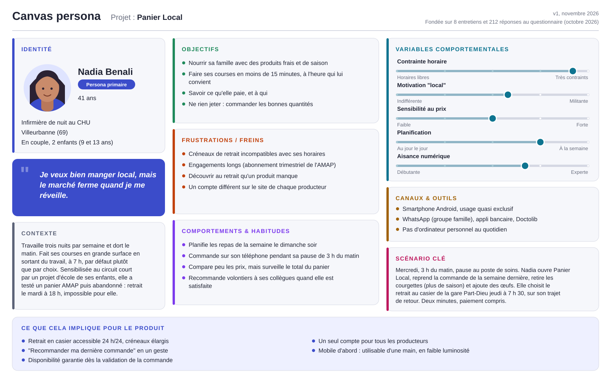

  <picture>
    <source media="(prefers-color-scheme: dark)" srcset="assets/Logo-diginamic-color-blk.png">
    
  </picture>

# La persona dans tous ses états

Un produit conçu "pour tout le monde" n'est conçu pour personne. La persona
répond à ce problème : un personnage fictif, mais construit à partir de données
réelles, qui incarne un groupe d'utilisateurs et sert de boussole à toutes les
décisions de conception.

Ce cours suit la méthode de bout en bout, de l'entretien à la fiche finale, sur
un exemple fil rouge (*Panier Local*, une plateforme de commande auprès de
producteurs locaux) et fournit les outils pour la refaire sur son propre
projet : un canvas graphique, un tableur et une fiche texte au format ouvert
OpenDocument.

## 🎯 Objectifs pédagogiques

À la fin de ce cours, vous saurez :

1. Expliquer ce qu'est une persona, à quoi elle sert, et ce qui la distingue
   d'une cible marketing ou d'un segment.
2. Préparer et mener une collecte de données utilisateurs : entretiens,
   observation, questionnaire, données existantes.
3. Analyser ces données avec des variables comportementales pour faire émerger
   des groupes d'utilisateurs.
4. Rédiger une persona crédible, utile et sans stéréotype, et choisir entre
   persona primaire, secondaire et anti-persona.
5. Mettre la persona en forme sur un canvas graphique et dans des documents
   partageables (tableur et texte OpenDocument).
6. Faire vivre la persona dans le projet : scénarios, priorisation,
   récits utilisateur, mises à jour.
7. Exploiter la persona dans le métier visé par votre titre.
8. Passer d'une persona d'usage à une persona commerciale, et inversement.

## 👥 À qui s'adresse ce cours ?

La méthode est commune ; l'insistance varie selon le titre préparé.

| Titre | Ce que la persona alimente | Chapitres prioritaires |
|---|---|---|
| **CDA** : Concepteur développeur d'applications | récits utilisateur, cas d'utilisation, critères d'acceptation, tests | 01, 03, 04, 07, 08 |
| **DWWM** : Développeur web et web mobile | maquettes, choix d'interface, accessibilité | 01, 04, 05, 07, 08 |
| **AMOA** : Consultant en assistance à maîtrise d'ouvrage informatique | recueil des besoins, ateliers, exigences, recette | 02, 03, 06, 07, 08, 09 |
| **EISI** : Expert en informatique et systèmes d'information | cadrage, arbitrage de portefeuille, personas d'exploitation et de sécurité | 01, 03, 07, 08 |
| **Métiers commerciaux** | ciblage, messages, argumentaire, parcours d'achat | 01, 04, 08, 09 |

## ❔ Pourquoi ce cours ?

La persona est l'un des outils les plus répandus de la conception centrée
utilisateur, et l'un des plus mal utilisés. Trop souvent, elle est inventée en
réunion, décorée d'une photo de banque d'images, affichée au mur… et oubliée.
Ce cours insiste sur les deux conditions qui en font un véritable outil de
travail : **elle repose sur des données**, et **elle sert à décider**.

## Le parcours

Chaque étape est un fichier. On les suit **dans l'ordre** : chacune s'appuie
sur ce que la précédente a produit.

| # | Étape | Ce qu'on y fait |
|---|---|---|
| [01](01-Comprendre-la-persona.md) | Comprendre la persona | définition, origine, usages, ce qu'une persona n'est pas, les types de personas |
| [02](02-Collecter-les-donnees.md) | Collecter les données | sources qualitatives et quantitatives, recrutement, guide d'entretien, grille de collecte |
| [03](03-Analyser-et-segmenter.md) | Analyser et segmenter | variables comportementales, placement des participants, émergence des groupes |
| [04](04-Rediger-la-persona.md) | Rédiger la persona | les rubriques, la citation, le scénario, les pièges à éviter |
| [05](05-Le-canvas-graphique.md) | Le canvas graphique | la persona sur une page : zones, lecture, exemple commenté |
| [06](06-Les-modeles-tableur-et-texte.md) | Les modèles tableur et texte | le classeur `.ods` de travail, la fiche `.odt` à diffuser |
| [07](07-Faire-vivre-la-persona.md) | Faire vivre la persona | scénarios, récits utilisateur, priorisation, validation, mise à jour |
| [08](08-La-persona-selon-votre-titre.md) | La persona selon votre titre | ce qu'en font CDA, DWWM, AMOA, EISI et les métiers commerciaux |
| [09](09-Persona-d-usage-et-persona-commerciale.md) | Persona d'usage et persona commerciale | les rubriques commerciales, les transferts dans les deux sens, le RGPD |
| [A](A-Ressources.md) | Ressources | glossaire, bibliographie, pour aller plus loin |
| [B](B-Outils-en-ligne.md) | Outils en ligne | outils gratuits (Digipad, Digiboard, Miro, Canva, HubSpot) : lequel choisir, générateurs par IA, RGPD |

## Les ressources fournies

| Fichier | Format | Contenu |
|---|---|---|
| `assets/persona-canvas-vierge.svg` | SVG | le canvas graphique, à imprimer ou à reprendre dans un outil de dessin |
| `assets/persona-canvas-exemple.svg` | SVG | le même canvas, rempli pour la persona de l'exemple |
| `modeles/persona-canvas-modele.ods` | tableur OpenDocument | le canvas à remplir au clavier, jauges calculées |
| `modeles/persona-canvas-exemple.ods` | tableur OpenDocument | le même canvas, rempli pour l'exemple |
| `modeles/persona-canvas-modele.odt` | texte OpenDocument | le canvas à remplir comme un document |
| `modeles/persona-canvas-exemple.odt` | texte OpenDocument | le même canvas, rempli pour l'exemple |
| `modeles/persona-tableur-modele.ods` | tableur OpenDocument | le classeur de travail vierge : entretiens, variables, fiche, priorisation |
| `modeles/persona-tableur-exemple.ods` | tableur OpenDocument | le même classeur, rempli avec les données de l'exemple |
| `modeles/persona-fiche-modele.odt` | texte OpenDocument | la fiche persona à diffuser, avec ses consignes de rédaction |
| `modeles/persona-fiche-exemple.odt` | texte OpenDocument | la fiche de l'exemple, canvas en annexe |

Les fichiers OpenDocument s'ouvrent avec LibreOffice, mais aussi avec
Microsoft Office, Google Docs / Sheets ou OnlyOffice.

