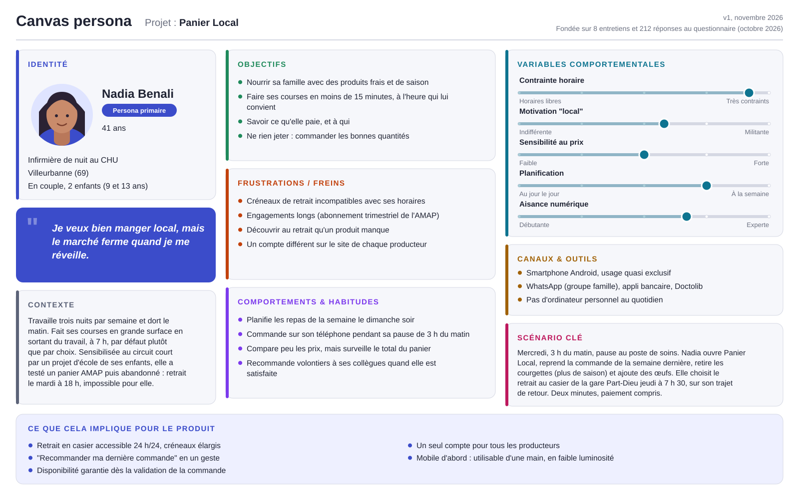

# La persona dans tous ses états

### De l'entretien à la fiche, sur un exemple complet

<!-- Fil rouge : Panier Local, plateforme de commande auprès de producteurs
     locaux. Persona primaire : Nadia Benali. -->

---

## 🎯 Objectifs pédagogiques

À la fin de ce cours, vous saurez :

1. Expliquer ce qu'est une persona et à quoi elle sert
2. Collecter des données utilisateurs
3. Analyser avec des variables comportementales
4. Rédiger une persona crédible et sans stéréotype
5. La mettre en forme : canvas, tableur, fiche texte
6. La faire vivre dans le projet
7. L'exploiter dans le métier de votre titre
8. Passer d'une persona d'usage à une persona commerciale, et inversement

---

## Le parcours

| #  | Étape                          |
|----|--------------------------------|
| 01 | Comprendre la persona          |
| 02 | Collecter les données          |
| 03 | Analyser et segmenter          |
| 04 | Rédiger la persona             |
| 05 | Le canvas graphique            |
| 06 | Les modèles tableur et texte   |
| 07 | Faire vivre la persona         |
| 08 | La persona selon votre titre   |
| 09 | Persona d'usage et commerciale |

---

# 1. Comprendre la persona

---

## Une définition

Un **personnage fictif**, **fondé sur des données**, qui représente un
**groupe d'utilisateurs** aux objectifs et comportements proches.

- popularisée par Alan Cooper (1999)
- met fin à "l'utilisateur élastique" que chacun imagine à sa façon
- ce qui compte : **objectifs** et **comportements**, pas le décor

> Une persona inventée est pire qu'une absence de persona.

---

## Ce qu'une persona n'est pas

| Ce n'est pas…            | … parce que                                         |
|--------------------------|-----------------------------------------------------|
| une cible marketing      | la cible dit qui achète, la persona comment on utilise |
| un segment               | le segment compte, la persona incarne               |
| l'utilisateur moyen      | la moyenne ne ressemble à personne                  |
| une fiche inventée       | sans données, elle fige les intuitions de l'équipe  |

---

## Les types de personas

| Type          | Rôle                                         | Exemple              |
|---------------|----------------------------------------------|----------------------|
| Primaire      | celle pour qui on conçoit en priorité        | Nadia, infirmière de nuit |
| Secondaire    | besoins qui s'ajoutent, sans contredire      | Hugo, militant du local |
| Anti-persona  | celle pour qui on ne conçoit **pas**         | le restaurateur en gros |

Rarement plus de cinq personas, **une seule primaire** par interface.

---

# 2. Collecter les données

---

## Qualitatif, puis quantitatif

- **Entretiens** : objectifs, contexte, verbatims
- **Observation** : l'écart entre le dire et le faire
- **Questionnaire** : combien de personnes dans chaque groupe
- **Données existantes** : statistiques, service client, avis

> Le qualitatif dit **pourquoi**, le quantitatif dit **combien**.

---

## Mener l'entretien

- recruter sur des **comportements**, pas sur l'âge ou la ville
- faire raconter **la dernière fois que…**
- ne **jamais** présenter la solution
- noter les **verbatims** mot pour mot
- s'arrêter à la **saturation**
- consentement, **anonymisation** : `P1`, `P2`…

---

# 3. Analyser et segmenter

---

## Les variables comportementales

Un axe entre deux pôles, sur lequel les participants **diffèrent**.

| Variable             | 1                | 5                 |
|----------------------|------------------|-------------------|
| Contrainte horaire   | horaires libres  | très contraints   |
| Motivation "local" | indifférente     | militante         |
| Sensibilité au prix  | faible           | forte             |
| Planification        | au jour le jour  | à la semaine      |
| Aisance numérique    | débutante        | experte           |

---

## Des notes aux groupes

| Groupe                     | Participants | Part du public |
|----------------------------|--------------|----------------|
| A : Contraints par l'horaire | P1, P2, P6 | 41 %           |
| B : Militants du local     | P3, P4, P8   | 28 %           |
| C : Vigilants sur le budget | P5, P7      | 31 %           |

- A → **Nadia**, persona primaire
- B → **Hugo**, persona secondaire
- C → non retenu en v1, décision écrite et argumentée

---

# 4. Rédiger la persona

---

## Les rubriques

**Qui** : identité, citation, contexte
**Ce qu'elle vit** : objectifs, frustrations, comportements
**Comment la servir** : variables, canaux, scénario clé
**Ce que cela implique** : décisions de conception, justifiées
**Traçabilité** : sources, version

> Chaque détail doit servir une décision.

---

## Citation et scénario

> "Je veux bien manger local, mais le marché ferme quand je me réveille."

*Mercredi, 3 h du matin, pause au poste de soins. Nadia reprend la commande de
la semaine dernière et choisit le casier de la gare, jeudi 7 h 30. Deux
minutes, paiement compris.*

- une citation **réelle**, qui porte une **tension**
- un scénario au présent, **sans décrire l'interface**

---

## Les pièges

- le **stéréotype** et la photo de banque d'images
- le **détail décoratif** : hobbies, voiture, animal
- la persona **élastique**, qui veut tout
- la persona **fourre-tout**, pour des groupes opposés
- la persona **orpheline** : ni source, ni version

---

# 5. Le canvas graphique

---



---

## Lire le canvas

- **Gauche** : qui est-elle ? identité, citation, contexte
- **Centre** : que vit-elle ? objectifs, frustrations, comportements
- **Droite** : comment la servir ? variables, canaux, scénario
- **Bandeau** : ce que cela implique pour le produit

Position d'un curseur = (moyenne du groupe − 1) / 4

---

# 6. Les modèles tableur et texte

---

## Trois documents, trois rôles

| Document         | Rôle                         | Public             |
|------------------|------------------------------|--------------------|
| Classeur `.ods`  | travail : données, calculs   | l'équipe persona   |
| Fiche `.odt`     | diffusion : la persona rédigée | toute l'équipe projet |
| Canvas `.svg` `.ods` `.odt` | vitrine : une page | mur, ateliers      |

Format **OpenDocument** : ouvert, normalisé, lisible partout.

---

## Le classeur, onglet par onglet

1. **Entretiens** : une ligne par participant, puis son groupe
2. **Variables** : notes de 1 à 5 → moyennes et curseurs calculés
3. **Fiche persona** : le contenu de chaque rubrique
4. **Priorisation** : notes de 0 à 3, pondérées → rang calculé

Cellules **jaunes** à saisir, **grises** calculées.

---

# 7. Faire vivre la persona

---

## La persona sert à décider

```text
En tant que Nadia,
je veux recommander ma dernière commande en un geste,
afin de faire mes courses pendant ma pause en moins de deux minutes.
```

- scénarios et **parcours**
- **récits utilisateur** nommés
- **priorisation** pondérée
- **tests** : recruter des personnes qui lui ressemblent

---

## Valider et mettre à jour

- relue par ceux qui ont mené les entretiens
- confrontée au quantitatif
- révisée après chaque vague de tests
- versionnée : l'historique dit ce qui a changé, et pourquoi

> Une persona qui ne sert pas meurt au mur.

---

# 8. La persona selon votre titre

---

## Une méthode, plusieurs métiers

| Titre        | La persona alimente…                                   |
|--------------|--------------------------------------------------------|
| DWWM         | maquettes, choix d'interface, accessibilité            |
| CDA          | récits, cas d'utilisation, critères d'acceptation, tests |
| AMOA         | recueil des besoins, ateliers, exigences, recette      |
| EISI         | cadrage, arbitrages, exploitation, sécurité            |
| Commercial   | ciblage, messages, argumentaire                        |

---

## DWWM : la persona derrière l'écran

| Persona                          | Décision d'interface                       |
|----------------------------------|--------------------------------------------|
| smartphone quasi exclusif        | *mobile first*                             |
| commande la nuit                 | thème sombre, contrastes élevés            |
| une main, fatigue                | cibles tactiles larges, actions en bas     |
| moins de deux minutes            | "recommander" en page d'accueil          |

Une maquette **annotée** : chaque annotation renvoie à la persona.
La persona est aussi un argument pour l'**accessibilité**.

---

## CDA : de la persona au modèle

- **Persona ≠ acteur ≠ rôle** : Nadia et Hugo sont deux personas de l'acteur *Client*
- Objectif → récit utilisateur → critères d'acceptation → tests
- Récit utilisateur → cas d'utilisation → modèle de données, API

> "Découvrir au retrait qu'un produit manque" devient une exigence
> d'architecture : le stock des producteurs entre dans le modèle.

---

## AMOA : la persona au service des métiers

- **Recueil** : guide d'entretien, grille de collecte
- **Ateliers** : le canvas met d'accord sur "pour qui" avant "quoi"
- **Exigences tracées** : chaque exigence → une persona → un objectif
- **Recette** : scénarios de recette tirés des scénarios des personas
- **Changement** : des **personas internes** pour les utilisateurs métiers

---

## EISI : la persona à l'échelle du SI

- **Cadrer** : le besoin repose-t-il sur des utilisateurs identifiés ?
- **Arbitrer** le portefeuille selon les personas servies et leur poids
- **Personas d'exploitation** : l'astreinte réveillée à 4 h
- **Anti-personas de sécurité** : le robot qui réserve tous les casiers
- **Piloter** : des indicateurs par persona

---

# 9. Persona d'usage et persona commerciale

---

## Deux questions

|                 | Persona d'usage            | Persona commerciale            |
|-----------------|----------------------------|--------------------------------|
| Question        | qui utilise, et comment ?  | qui achète, et pourquoi ?      |
| Sert à          | concevoir, prioriser, tester | cibler, convaincre, vendre   |
| Rubriques clés  | objectifs, frustrations, scénario | déclencheurs, freins, critères, parcours d'achat |
| Sources         | entretiens d'usage, observation | entretiens d'acheteurs, CRM, ventes |

En B2C, souvent la même personne. En B2B, rarement.

---

## Usage → commercial

| Persona d'usage   | devient…                  |
|-------------------|---------------------------|
| objectifs         | bénéfices                 |
| frustrations      | objections à lever        |
| citation          | accroche, ton             |
| canaux            | canaux d'acquisition      |
| comportements     | moments de contact        |
| scénario          | démonstration             |

**À ajouter** : déclencheur, parcours d'achat, critères, valeur.
**Piège** : ne promettre que ce que le produit livre vraiment.

---

## Commercial → usage

*Sophie, secrétaire du CSE d'un hôpital (persona commerciale)*

| Persona commerciale    | devient…                 |
|------------------------|--------------------------|
| freins perçus          | frustrations à résoudre  |
| critères de décision   | objectifs d'usage        |
| contexte, contraintes  | contexte                 |

**À vérifier** : l'acheteur n'est pas forcément l'utilisateur ; une persona
bâtie sur l'avis des commerciaux est une **proto-persona**.

---

## RGPD et finalité

- la **persona**, fictive et agrégée, se partage entre équipes
- les **données brutes** restent à l'équipe qui les a collectées
- **jamais** de prospection à partir d'un entretien de recherche
- un double usage prévu ? on l'**annonce** au consentement

> Une seule persona, deux vues : un socle commun, une vue d'usage,
> une vue commerciale.

---

## Outils en ligne gratuits

| Besoin                          | Outil                                   |
|---------------------------------|-----------------------------------------|
| construire à partir des données | le classeur `.ods` du cours             |
| atelier en présentiel           | le canvas imprimé en A3                 |
| atelier à distance, sans compte | Digipad, Digiboard (La Digitale)        |
| atelier avec modèle prêt        | Miro (plan gratuit, en français)        |
| présenter                       | le canvas du cours, Canva               |
| vue commerciale                 | HubSpot Make My Persona (en anglais)    |

> Un outil rend une persona présentable, pas vraie.
> Générée par IA, c'est une **proto-persona**. Jamais de données d'entretien en ligne.

---

# Des questions ?

### Les modèles sont dans `modeles/` et `assets/`

Pour toute question [adressez-vous au service pédagogie](mailto:pedagogie@diginamic.fr)
